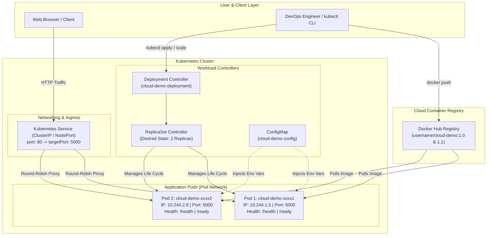

# Design and Implementation of a Cloud-Based Containerization and Kubernetes Orchestration System

[](https://www.python.org/)
[](https://flask.palletsprojects.com/)
[](https://www.docker.com/)
[](https://kubernetes.io/)
[](https://opensource.org/licenses/MIT)

---

## 1. Executive Summary & Objective

This project demonstrates an enterprise-grade, cloud-native DevOps workflow designed for college laboratory coursework, technical vivas, and portfolio demonstrations. It takes a custom microservice (**Cloud Demo App** built with Python Flask and Gunicorn), packages it into an optimized and secure Docker container image, publishes it to Docker Hub, and orchestrates it across a multi-node Kubernetes cluster.

### Core Capabilities Demonstrated
- **Microservice Containerization:** Lightweight Debian-based Python container running under a dedicated non-root user (`UID 1000`).
- **Cloud Registry Publishing:** Version-tagged image push and pull workflows on Docker Hub.
- **Declarative Kubernetes Management:** Structured YAML manifests for `ConfigMap`, `Deployment`, and `Service`.
- **High Availability & Horizontal Scaling:** Dynamic replica adjustments (`2 -> 3 -> 1 Pods`) with load distribution.
- **Autonomous Self-Healing:** Automatic detection and replacement of deleted or terminated Pods via the `ReplicaSet` controller.
- **Continuous Health Probing:** Integration of `livenessProbe` (`/health`) and `readinessProbe` (`/ready`).
- **Zero-Downtime Rolling Update & Rollback:** Seamless atomic transitions between application versions (`v1.0` to `v1.1`) and instant rollback upon simulated failure.

---

## 2. System Architecture



---

## 3. Technology Stack Comparison & Cloud Playground Selection

To guarantee a **100% free, reproducible prototype** without requiring paid cloud credit cards (e.g., AWS EKS or GCP GKE, which charge ~$73/month just for the cluster control plane), use one of the verified environments below:

| Environment | Cost | Credit Card Needed? | Docker Build Support? | Kubernetes Cluster? | Browser Web Preview? | Session Lifespan | Recommendation |
| :--- | :--- | :--- | :--- | :--- | :--- | :--- | :--- |
| **Killercoda Kubernetes Playground** | Free | **No** | Yes (Built-in) | Full multi-node / single-node | Built-in Port Preview tab | 60 mins (renewable) | **Primary Recommended** |
| **Play with Kubernetes (PWK)** | Free | **No** | Yes (Docker-in-Docker) | Real Kubeadm cluster | Built-in Port click | 4 hours | Excellent alternative |
| **Local Kind / Minikube** | Free | **No** | Yes (Local Docker Desktop) | Yes (Local VM / Docker) | `localhost:8080` | Permanent | Recommended if Docker is installed |
| **Docker Hub** | Free | **No** | N/A (Registry) | N/A | Web UI catalog | Permanent | Registry of choice |

---

## 4. Repository Structure

```
cloud-k8s-demo/
├── app.py                     # Python Flask microservice source code
├── requirements.txt           # Pinned production dependencies (Flask, Gunicorn)
├── Dockerfile                 # Multi-stage/secure non-root container specification
├── .dockerignore              # Prevents transient files from polluting images
├── .gitignore                # Protects secrets, cache, and virtual environments
├── k8s/                       # Declarative Kubernetes Manifests
│   ├── configmap.yaml         # Application runtime configuration
│   ├── deployment.yaml        # Deployment with probes, limits, Downward API
│   ├── service.yaml           # ClusterIP service definition
│   └── service-nodeport.yaml  # Optional NodePort service for playgrounds
├── tests/
│   └── test_app.py            # Automated unit and integration test suite
└── README.md                  # Complete architectural & operational guide
```

---

## 5. Step-by-Step Implementation Guide

### Prerequisites
1. A free [Docker Hub Account](https://hub.docker.com/).
2. A free browser session on [Killercoda Kubernetes Playground](https://killercoda.com/playgrounds/scenario/kubernetes) (or Play with Kubernetes), OR a local environment with Docker & kubectl installed.

> [!IMPORTANT]
> Replace all occurrences of `<DOCKERHUB_USERNAME>` with your actual Docker Hub username in commands and manifests.

---

### Step 1: Clone or Create the Project Files

Create the directory and navigate into it:
```bash
mkdir -p cloud-k8s-demo/k8s cloud-k8s-demo/tests
cd cloud-k8s-demo
```

Verify that all files (`app.py`, `requirements.txt`, `Dockerfile`, manifests) are in place.

---

### Step 2: Run Unit Tests Locally

```bash
# Optional: create a local virtualenv
python -m venv .venv
source .venv/bin/activate  # On Windows: .venv\Scripts\activate
pip install -r requirements.txt

# Run the automated test suite
python -m unittest discover tests
```

**Expected Output:**
```
........
----------------------------------------------------------------------
Ran 8 tests in 0.081s

OK
```

---

### Step 3: Containerize with Docker

#### 1. Build the Docker Image (Version 1.0)
```bash
docker build -t <DOCKERHUB_USERNAME>/cloud-demo:1.0 .
```

#### 2. Run the Container Locally for Verification
```bash
docker run -d --name test-cloud-demo -p 5000:5000 <DOCKERHUB_USERNAME>/cloud-demo:1.0
```

#### 3. Test Container Endpoints
```bash
# Test homepage
curl -i http://localhost:5000/

# Test health check
curl -i http://localhost:5000/health

# Test version
curl -i http://localhost:5000/version
```

#### 4. Inspect Container Logs
```bash
docker logs test-cloud-demo
```

#### 5. Stop and Clean Up Local Container
```bash
docker stop test-cloud-demo && docker rm test-cloud-demo
```

---

### Step 4: Publish the Image to Docker Hub

#### 1. Log in to Docker Hub
```bash
docker login
# Enter your Docker Hub Username and Password / Access Token
```

#### 2. Push Image v1.0
```bash
docker push <DOCKERHUB_USERNAME>/cloud-demo:1.0
```

**Expected Output:**
```
The push refers to repository [docker.io/<DOCKERHUB_USERNAME>/cloud-demo]
...
1.0: digest: sha256:7f4a... size: 1368
```

---

### Step 5: Deploy to Kubernetes

#### 1. Configure Manifest with Your Image
Open `k8s/deployment.yaml` and replace `DOCKERHUB_USERNAME` with your actual username:
```bash
# On Linux/macOS/Killercoda:
sed -i 's/DOCKERHUB_USERNAME/<DOCKERHUB_USERNAME>/g' k8s/deployment.yaml
```

#### 2. Apply ConfigMap, Deployment, and Service
```bash
kubectl apply -f k8s/configmap.yaml
kubectl apply -f k8s/deployment.yaml
kubectl apply -f k8s/service.yaml
```

**Expected Output:**
```
configmap/cloud-demo-config created
deployment.apps/cloud-demo-deployment created
service/cloud-demo-service created
```

#### 3. Verify Deployment & Pod Status
```bash
kubectl get deployments
kubectl get pods -o wide
kubectl get services
```

**Representative Output:**
```
NAME                    READY   UP-TO-DATE   AVAILABLE   AGE
cloud-demo-deployment   2/2     2            2           25s

NAME                                     READY   STATUS    RESTARTS   AGE   IP           NODE
cloud-demo-deployment-75f8546b97-abc12   1/1     Running   0          25s   10.244.1.4   node-1
cloud-demo-deployment-75f8546b97-xyz89   1/1     Running   0          25s   10.244.2.6   node-2
```

---

### Step 6: Access Application in Browser

#### Option A: Using `kubectl port-forward` (Works in All Environments)
```bash
kubectl port-forward svc/cloud-demo-service 8080:80
```
Open your browser and navigate to:
```
http://localhost:8080
```
On Killercoda: Click the **Traffic / Ports** menu, enter `8080`, and click **Access**.

#### Option B: Using NodePort (Killercoda / Play with Kubernetes)
```bash
kubectl apply -f k8s/service-nodeport.yaml
```
Open port `30080` in the browser preview.

---

### Step 7: Demonstrate Horizontal Scaling

#### 1. Scale Up to 3 Replicas
```bash
kubectl scale deployment cloud-demo-deployment --replicas=3
kubectl get pods -w
```
Watch a 3rd Pod transition from `ContainerCreating` to `Running` and pass readiness probes.

#### 2. Scale Down to 1 Replica
```bash
kubectl scale deployment cloud-demo-deployment --replicas=1
kubectl get pods
```
Notice Kubernetes gracefully terminates 2 Pods, preserving exactly 1 healthy instance.

#### 3. Restore to 2 Replicas (Production Baseline)
```bash
kubectl scale deployment cloud-demo-deployment --replicas=2
```

---

### Step 8: Demonstrate Self-Healing

1. List the current running Pods:
   ```bash
   kubectl get pods
   ```
   Note the name of one Pod (e.g. `cloud-demo-deployment-75f8546b97-abc12`).

2. Manually delete that Pod:
   ```bash
   kubectl delete pod cloud-demo-deployment-75f8546b97-abc12
   ```

3. Immediately inspect the Pod list:
   ```bash
   kubectl get pods
   ```
   **Observation:** The deleted Pod enters `Terminating` status, while the `ReplicaSet` controller instantaneously schedules a brand new replacement Pod with a new unique suffix and IP!

---

### Step 9: Demonstrate Zero-Downtime Rolling Update & Rollback

#### 1. Prepare Version 1.1
In `k8s/configmap.yaml`, update `APP_VERSION` to `"1.1.0"`.

Build and push the new container image tagged as `1.1`:
```bash
docker build -t <DOCKERHUB_USERNAME>/cloud-demo:1.1 .
docker push <DOCKERHUB_USERNAME>/cloud-demo:1.1
```

#### 2. Apply ConfigMap and Trigger Rolling Update
```bash
kubectl apply -f k8s/configmap.yaml
kubectl set image deployment/cloud-demo-deployment cloud-demo=<DOCKERHUB_USERNAME>/cloud-demo:1.1 --record
```

#### 3. Monitor Rollout in Real Time
```bash
kubectl rollout status deployment/cloud-demo-deployment
```

**Expected Output:**
```
Waiting for deployment "cloud-demo-deployment" rollout to finish: 1 out of 2 new replicas have been updated...
Waiting for deployment "cloud-demo-deployment" rollout to finish: 1 old replicas are pending termination...
deployment "cloud-demo-deployment" successfully rolled out
```

#### 4. Verify Version 1.1 Live
```bash
curl http://localhost:8080/version
# Returns: {"appName":"Cloud Demo App","version":"1.1.0",...}
```

#### 5. Demonstrate Instant Rollback (Simulating Emergency Recovery)
If an issue occurs in production, revert immediately to the previous revision:
```bash
kubectl rollout history deployment/cloud-demo-deployment
kubectl rollout undo deployment/cloud-demo-deployment
kubectl rollout status deployment/cloud-demo-deployment
```

Recheck `/version`:
```bash
curl http://localhost:8080/version
# Returns: {"appName":"Cloud Demo App","version":"1.0.0",...}
```

---

## 6. Troubleshooting Matrix

| Symptom / Status | Underlying Cause | Diagnostic Command | Corrective Action |
| :--- | :--- | :--- | :--- |
| `ErrImagePull` / `ImagePullBackOff` | Docker Hub repository name typo, tag does not exist, or image is private. | `kubectl describe pod <POD_NAME>` (Look at Events) | Correct image name/tag in `deployment.yaml` or run `docker push`. |
| `CrashLoopBackOff` | Application code crashed upon startup (e.g. syntax error, missing dependency). | `kubectl logs <POD_NAME> --previous` | Check traceback in container logs; fix code and rebuild. |
| `Pending` Pod | Insufficient CPU/Memory on nodes, or no worker nodes available. | `kubectl describe pod <POD_NAME>` | Reduce `resources.requests` in `deployment.yaml` or add nodes. |
| Pod `0/1 Running` (Unready) | `readinessProbe` failing (`/ready` returning 5xx or timeout). | `kubectl describe pod <POD_NAME>` (Readiness Probe events) | Check `/ready` endpoint logic or increase `initialDelaySeconds`. |
| Service Not Routing Traffic | Label selector mismatch between Service and Deployment. | `kubectl get endpoints cloud-demo-service` | Verify `spec.selector.app` matches `template.metadata.labels.app`. |

---

## 7. College Viva & Presentation Guide

### 5-Minute Live Demonstration Script
1. **Minute 0:00 - 1:00 (Context):** Introduce the problem of monolithic deployment vs cloud-native containerization. Show the responsive Flask homepage running in a container.
2. **Minute 1:00 - 2:00 (Kubernetes Architecture):** Show `kubectl get pods -o wide` and explain how Kubernetes distributes 2 Pods across worker nodes with isolated IPs.
3. **Minute 2:00 - 3:00 (Self-Healing Demonstration):** Run `kubectl delete pod <POD_NAME>`. Show the class that within 2 seconds, the `ReplicaSet` detects the divergence from desired state and provisions a replacement.
4. **Minute 3:00 - 4:00 (Horizontal Scaling):** Execute `kubectl scale deployment cloud-demo-deployment --replicas=3`. Refresh the browser to prove round-robin load distribution across container hostnames.
5. **Minute 4:00 - 5:00 (Rolling Update & Rollback):** Execute `kubectl set image ...:1.1`. Show zero-downtime transition, then run `kubectl rollout undo` to demonstrate safety net.

### Essential Screenshots to Capture for Your Project Report
1. `docker build` and `docker push` terminal output showing successful registry upload.
2. Docker Hub repository page showing tags `1.0` and `1.1`.
3. `kubectl get all` showing Deployments, ReplicaSets, Pods, and Services.
4. Browser view of the **Cloud Demo App** showing Container Hostname, Status, and Kubernetes banner.
5. Terminal output of `kubectl delete pod` showing immediate self-healing.
6. Terminal output of `kubectl rollout status` and `kubectl rollout undo`.

---

## 8. Limitations and Future Improvements

### Current Prototype Scope
- In-memory simulated health state.
- Stateless HTTP microservice without persistent database layer.
- Single-cluster testing using port-forwarding / playground ingress.

### Future Industry Enhancements
- **Ingress Controller & TLS:** Add NGINX Ingress Controller with Let's Encrypt automated SSL certificates.
- **CI/CD Automation:** Implement GitHub Actions pipeline to automatically build, test, and deploy to Kubernetes on `git push`.
- **Autoscaling (HPA):** Deploy `HorizontalPodAutoscaler` based on CPU/Memory metrics server.
- **Monitoring & Observability:** Integrate Prometheus metrics scraper and Grafana dashboard for live telemetry.
